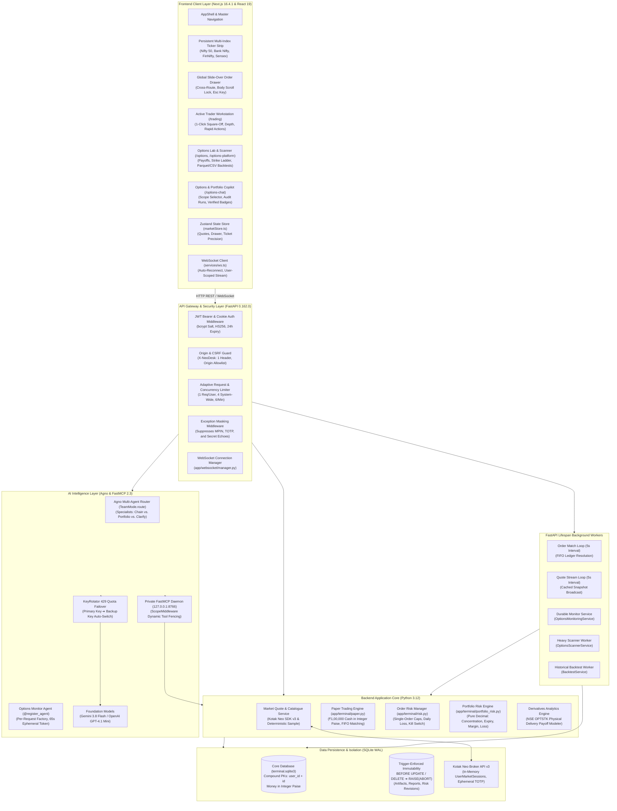
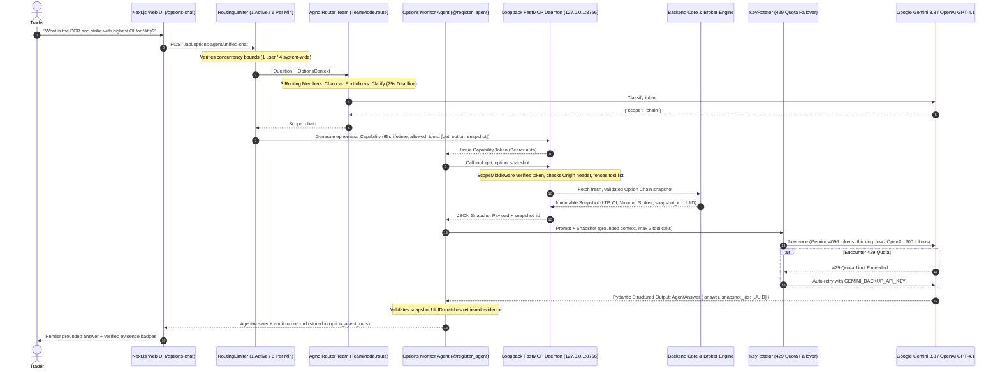

# NeoDesk — Indian Markets Active Trading & Options Intelligence Terminal

[]()
[](https://www.python.org/)
[](https://nextjs.org/)
[](https://fastapi.tiangolo.com/)
[](https://github.com/Kotak-Neo/kotak-neo-python)
[](https://modelcontextprotocol.io/)
[](https://github.com/agno-agi/agno)

A multi-user Indian financial market trading terminal, active trader workstation, and derivatives intelligence platform. NeoDesk unites live NSE/BSE market data, order routing via Kotak Neo, simulated paper portfolios with strict user isolation, an institutional-grade options analytics engine, and an AI chat assistant powered by the Model Context Protocol (MCP) and Agno.

---

## 🏛️ Comprehensive System Design & Architecture

NeoDesk is built with a decoupled client-server architecture engineered for sub-second responsiveness, zero credential leakage, multi-tenant isolation, and mathematically verifiable options analysis.

### End-to-End System Architecture



---

### Detailed Architectural Subsystems

#### 1. Authentication, Multi-Tenancy & Zero-Storage Broker Security
- **Dual-Token Authentication Pipeline**:
  - User accounts are registered with email, display name, and password. Plaintext passwords are salted and hashed using `bcrypt` (`bcrypt.gensalt()`, `bcrypt.hashpw`).
  - Upon successful authentication, the server generates an HS256 JSON Web Token (`create_token`) with a 24-hour expiration.
  - The token is delivered both as a JSON payload (`access_token`) for the `Authorization: Bearer <token>` header and as an `HttpOnly`, `SameSite=Strict` cookie (`neodesk_token`) for seamless browser navigation.
  - Legacy backward compatibility is preserved via optional `APP_PASSWORD` and `neodesk_session` tokens.
- **Zero-Storage Broker Credentials**:
  - Kotak Neo credentials (`consumer_key`, `ucc`, `mobile`, `totp`, `mpin`) are received over HTTPS via `/api/auth/kotak-login` or `/api/connection/login`.
  - MPIN and TOTP are strictly ephemeral: **they are never written to SQLite, logs, or disk files**.
  - Active broker sessions are maintained exclusively in server RAM as `UserMarketSession` instances inside `Market.user_sessions[user_id]`.
  - When the FastAPI backend restarts, all broker session states instantly vanish from RAM.
  - Multi-tenant broker identity mapping: The `broker_identities` table maps the SHA-256 hash `sha256(f'kotak:{ucc.upper()}'.encode()).hexdigest()` to the tenant's `user_id`, preventing account collisions.
- **Session Generation Fencing**:
  - Each `UserMarketSession` generates a cryptographic UUID token (`generation = str(uuid4())`).
  - Long-running operations and MCP snapshot evaluations execute `assert_generation(user_id, session_generation)`. If the user disconnects or re-authenticates, the session generation changes and running background work is safely aborted.

#### 2. SQLite WAL Storage & Trigger-Enforced Immutability
- **WAL Mode & Busy Handling**:
  - SQLite operates in Write-Ahead Logging mode (`PRAGMA journal_mode=WAL; PRAGMA busy_timeout=1000`), allowing non-blocking concurrent reads while background workers execute writes.
- **Compound Primary Key Multi-Tenancy**:
  - Multi-tenant isolation is enforced at the database schema level with compound primary keys and owner checks:
    - `positions (user_id, instrument_id)`
    - `futures_positions (user_id, instrument_id)`
    - `watchlist (user_id, instrument_id)`
    - `orders (user_id, request_id)`
    - `live_requests (user_id, request_id)`
    - `portfolio_risk_policy_revisions (user_id, revision)`
  - All platform store functions validate caller ownership via `_owner(user_id)` assertions (`type(user_id) is int and user_id > 0`).
- **Trigger-Enforced Immutability**:
  - Financial audit trails, strategy artifacts, and risk assessments are cryptographically and database-level immutable. SQLite triggers reject modifications:
    ```sql
    CREATE TRIGGER options_platform_no_update BEFORE UPDATE ON options_platform_artifacts
      BEGIN SELECT RAISE(ABORT, 'immutable platform artifact'); END;
    CREATE TRIGGER options_platform_no_delete BEFORE DELETE ON options_platform_artifacts
      BEGIN SELECT RAISE(ABORT, 'immutable platform artifact'); END;
    CREATE TRIGGER portfolio_risk_reports_immutable BEFORE UPDATE ON portfolio_risk_reports
      BEGIN SELECT RAISE(ABORT, 'immutable risk report'); END;
    CREATE TRIGGER scan_report_no_update BEFORE UPDATE ON platform_scan_reports
      BEGIN SELECT RAISE(ABORT, 'immutable scan report'); END;
    CREATE TRIGGER backtest_report_no_update BEFORE UPDATE ON options_backtest_reports
      BEGIN SELECT RAISE(ABORT, 'immutable backtest report'); END;
    ```
- **Integer Paise Representation**:
  - All fiat money balances (account cash, starting balance, order limit prices, fill prices, position costs) are stored in integer paise (₹1.00 = 100 paise) to eliminate floating-point rounding errors.

#### 3. Market Data Pipeline & Catalogue Matching
- **Dual-Source Market Engine**:
  - Configurable between `sample` (deterministic synthetic market feed for offline simulation and automated tests) and `kotak` (live broker API).
- **Catalogue Scrip Master Ingestion**:
  - Downloads and normalizes over 139,000+ instruments across 4 NSE/BSE market segments: `nse_cm` (NSE Cash), `bse_cm` (BSE Cash), `nse_fo` (NSE Derivatives), and `bse_fo` (BSE Derivatives).
  - Normalizes scrip lot sizes, tick sizes, strike prices (converted from paise), expiry dates, option types (`CE`/`PE`), and contract types (`EQUITY`, `INDEX`, `ETF`, `OPTION`, `FUTURE`).
- **Quote Streaming & WebSocket Architecture**:
  - `Market.quotes(...)` fetches batched quote snapshots (up to 50 instruments per batch) with thread-safe caching (`RLock`).
  - `sfeed_loop` runs every 5 seconds, broadcasting fresh validated quotes over the WebSocket connection manager (`app/websocket/manager.py`) to active user sessions.

#### 4. Paper Trading Engine & Order Execution
- **Double-Entry Cash & Asset Reservation**:
  - When a paper `BUY` limit order is placed, `cash_required = quantity * limit_price` is immediately reserved from the user's available cash balance.
  - When a paper `SELL` limit order is placed, the required quantity is immediately reserved from the user's held position lots, preventing over-selling.
- **FIFO Matching Engine**:
  - `match_loop` runs every 5 seconds in the background. It queries open orders, checks market LTP against limit prices, and executes fills using First-In-First-Out (FIFO) trade accounting.
  - Realized P&L is booked immediately upon matching; unrealized P&L is updated dynamically as market prices change.
- **Live Trading Safety Latch**:
  - Live order routing through Kotak Neo requires **both** `LIVE_TRADING_ENABLED=true` in `.env` and an authenticated broker session.
  - Idempotent request tokens (`request_id` in `live_requests` table) protect against accidental duplicate order submissions.

#### 5. Dual-Layer Risk Management System
- **Layer 1: Interactive Order Risk Manager (`app/terminal/risk.py`)**:
  - Evaluated synchronously before any order (paper or live) is dispatched:
    - `max_order_value`: Caps total order value at ₹5,00,000 (configurable).
    - `max_daily_loss`: Restricts cumulative daily realized loss to ₹25,000.
    - `max_price_deviation_pct`: Blocks limit orders straying > 10% from current LTP.
    - `max_quantity_per_order`: Caps single-order volume at 10,000 units.
    - `kill_switch_active`: Master circuit breaker that halts all order placement immediately when triggered.
- **Layer 2: Portfolio Risk Assessment Engine (`app/terminal/portfolio_risk.py`)**:
  - Pure `Decimal` mathematical evaluation with strict arithmetic contexts (24 digits max, exponent bounds, no IEEE 754 precision loss):
    - `concentration`: Single-underlying portfolio exposure ceiling (`concentration_max_percent`).
    - `expiry`: Warning threshold for contracts expiring within $N$ days (`expiry_window_days`).
    - `margin`: Margin utilization ratio against broker account limits (`margin_max_percent`).
    - `loss`: Maximum allowable unrealized/realized portfolio drawdown (`loss_max_amount`).
  - Observation Freshness Checks: Rejects stale data with `stale_observation` errors if the observation timestamp exceeds the configured freshness window.

#### 6. Derivatives Analytics & Historical Engine
- **Options Payoff Modeler (`options_strategies.py`)**:
  - Evaluates multi-leg options structures (Bull Call Spreads, Bear Put Spreads, Long Straddles, Strangles, Iron Condors).
  - Implements **SEBI / NSE physical delivery settlement rules** for equity derivatives (`nse-optstk-physical-2019.v1`) under SEBI Circulars `SEBI/HO/MRD/DP/CIR/P/2018/144` and `INSP/47293`, distinguishing cash-settled index options from physically delivered stock options.
- **Durable Scanner & Heavy Job Lease Queue (`options_scanner.py`, `options_scan_jobs.py`)**:
  - Scans contracts by Moneyness (ITM/ATM/OTM), IV percentiles, volume surges, and OI concentration.
  - Shared heavy job queue (`platform_heavy` table) manages scanner and backtest leases with concurrency caps (max 20 heavy jobs) and exponential backoff retry handling.
- **Historical Backtesting Engine (`options_backtest.py`, `options_backtest_jobs.py`)**:
  - Offline event replay cursor with matched covered fills and physical ledger tracking.
  - Ingests Parquet and CSV historical datasets (up to 10 MiB) with deterministic SHA-256 content hashing.
  - Models realistic transaction costs, exchange turnover fees, GST, STT, and unitized drawdowns.

---

## 🤖 Implemented AI Agents Architecture

The platform features an enterprise-grade agentic workflow built on the **Model Context Protocol (MCP)** and **Agno**, designed to ensure strict financial correctness, mathematical grounding, and zero unassisted live execution.

### Multi-Agent Interaction & Tool Fencing Sequence



---

### Detailed Agent Inventory & Tool Specifications

| Agent | Scope | Primary Tools | Model & Budget | Core Responsibility |
|---|---|---|---|---|
| **Chat Router Team** | Global | `TeamMode.route` | `gemini-3.8-flash` / `gpt-4.1-mini` | Inspects user query using 3 inline specialists (`chain`, `portfolio`, `clarify`). Routes to appropriate handler within a 25-second deadline. |
| **Options Specialist** | `chain` | `get_option_snapshot` | Max 2 tool calls, 4096 tokens (Gemini) / 900 tokens (OpenAI) | Analyzes option chains, PCR, strike-level OI, and premiums. Enforces explicit disclosures on unverified broker REST freshness. |
| **Portfolio Risk Agent** | `portfolio` | `get_portfolio_snapshot` | Max 2 tool calls, 4096 tokens (Gemini) / 900 tokens (OpenAI) | Evaluates holdings, positions, cash funds, order statuses, and checks portfolio risk policies (`concentration`, `expiry`, `margin`, `loss`). |
| **Strategy Report Explainer** | `strategy` | `get_strategy_report` | Max 2 tool calls, 4096 tokens (Gemini) / 900 tokens (OpenAI) | Explains immutable multi-leg strategy payoff models, physical delivery obligations, breakevens, and margin requirements. |
| **Scanner Report Explainer** | `scan` | `get_scan_report` | Max 2 tool calls, 4096 tokens (Gemini) / 900 tokens (OpenAI) | Explains screener results, candidate rankings, IV filter criteria, and exclusion lists. |
| **Alert Report Explainer** | `alert` | `get_alert_report` | Max 2 tool calls, 4096 tokens (Gemini) / 900 tokens (OpenAI) | Explains durable monitoring alerts, threshold crossings, and state transitions. |
| **Backtest Report Explainer** | `backtest` | `get_backtest_report` | Max 2 tool calls, 4096 tokens (Gemini) / 900 tokens (OpenAI) | Explains historical backtest results, slippage assumptions, fee impact, and unitized drawdown trajectories. |

---

### Agent Security, Guardrails & Harness Controls

1. **Private Loopback FastMCP Server (`127.0.0.1:8766`)**:
   - The MCP daemon runs on a dedicated internal loopback listener via Uvicorn.
   - Non-empty `Origin` headers are immediately rejected with HTTP 401, completely preventing browser-based CSRF attacks or cross-origin exploitation.
   - Capabilities are cryptographically generated server-side using `secrets.token_urlsafe(32)` with a strict 65-second lifetime (`time.monotonic() + 65`).
2. **Dynamic Tool Isolation via `ScopeMiddleware`**:
   - The FastMCP server registers 6 distinct tools: `get_option_snapshot`, `get_portfolio_snapshot`, `get_strategy_report`, `get_scan_report`, `get_alert_report`, and `get_backtest_report`.
   - `ScopeMiddleware` intercepts `on_list_tools` and `on_call_tool`:
     - Dynamically filters tool discovery so the agent only sees the **single tool** authorized for its specific capability scope.
     - Rejects any tool call outside the authorized capability scope with `ToolError('Tool unavailable for this request.')`.
3. **Strict Execution & Token Budgets**:
   - Hard server-side call limit: Maximum 3 total MCP reads per capability (1 prefetch + 2 model calls).
   - Agent tool call limit: `tool_call_limit=2`.
   - Hard generation token limits: 4096 tokens for Google Gemini (`BoundedGemini` with thinking level `'low'`) and 900 tokens for OpenAI (`BoundedOpenAIChat`).
   - Request deadline: 60-second monotonic request deadline.
4. **Deterministic Evidence Verification**:
   - The model cannot answer from parametric memory alone. Output schemas (`AgentAnswer`, `PortfolioAnswer`, `ReportAnswer`) require citing the exact `snapshot_id`, `evidence_id`, or `report_id`.
   - If an agent generates an answer with an incorrect or invented ID, Pydantic validation fails and the response is rejected before reaching the user.
5. **Execution Safety Latch**:
   - Agents are strictly **read-only** (`readOnlyHint: True, destructiveHint: False, openWorldHint: False`).
   - The agent harness possesses zero order placement, fund transfer, or credential modification authority.
   - Any order placement must be explicitly composed by the user on the Trade Ticket and confirmed interactively.
6. **Adaptive Rate Limiting & Concurrency Throttling**:
   - `RoutingLimiter` restricts concurrent chat traffic:
     - 1 active request per user.
     - Maximum 4 concurrent requests system-wide.
     - Maximum 6 requests per minute per user.
7. **Dual-Key Quota Failover (`KeyRotator`)**:
   - Automatic single-retry failover: When a primary API key hits a HTTP 429 quota limit, `KeyRotator` immediately retries the request using `GEMINI_BACKUP_API_KEY` or `OPENAI_BACKUP_API_KEY` without interrupting the user.

---

## ⚡ Active Trader Workstation (`/trading`)

- **Persistent Multi-Index Ticker Strip**:
  - Live tracking of Nifty 50, Nifty Bank, FinNifty, and Sensex.
  - Sub-second UI updates with color-coded positive/negative badges.
- **Global Slide-Over Order Drawer**:
  - Fly-out trade drawer accessible from any route (`/trading`, `/options`, `/stocks`, `/indices`).
  - Supports keyboard shortcuts (`Esc` dismissal) and body scroll lock to prevent scroll stuttering.
- **One-Click Position Square-Off**:
  - Instantly computes inverse order side (`BUY` ↔ `SELL`) and net position quantity.
  - Automatically loads order details into the Trade Ticket with pre-computed margin and limit checks.
- **High-Density Order Book & Market Table**:
  - Compact row layouts displaying LTP, Change %, Volume, Day High/Low, and instant 1-click Buy/Sell triggers.

---

## 🚀 Quick Start

### Prerequisites
- **Node.js**: v20.x or higher (tested on Node.js 24)
- **Python**: v3.12.x
- **PowerShell** (Windows) or **Bash** (macOS/Linux)

### 1. One-Command Launch (Recommended)
From the repository root in PowerShell:
```powershell
cd neo-trading-terminal
.\run-local.ps1
```
This builds the Next.js frontend, bundles the static distribution, and starts the FastAPI server at `http://127.0.0.1:8000`.

To skip rebuilding the frontend if files haven't changed:
```powershell
.\run-local.ps1 -SkipBuild
```

### 2. Manual Installation

#### Backend Setup
```powershell
cd neo-trading-terminal/backend

# Create and activate virtual environment
python -m venv .venv
.\.venv\Scripts\Activate.ps1

# Install locked dependencies
pip install -r requirements.txt -c requirements.lock
```

#### Frontend Setup
```powershell
cd neo-trading-terminal/frontend
npm ci
```

#### Running in Development Mode
Run each service in a separate terminal:
```powershell
# Terminal 1 - Backend (FastAPI on http://127.0.0.1:8000)
cd neo-trading-terminal/backend
.\.venv\Scripts\Activate.ps1
uvicorn app.main:app --reload --host 127.0.0.1 --port 8000

# Terminal 2 - Frontend (Next.js on http://localhost:3000)
cd neo-trading-terminal/frontend
npm run dev
```

---

## ⚙️ Configuration (`.env`)

Copy `.env.example` in `neo-trading-terminal/` to `.env`:
```powershell
cd neo-trading-terminal
cp .env.example .env
```

| Environment Variable | Default | Purpose |
|----------------------|---------|---------|
| `ENVIRONMENT` | `development` | Runtime mode (`development`, `production`, `test`) |
| `TRADING_MODE` | `paper` | Order execution mode (`paper` or `live`) |
| `LIVE_TRADING_ENABLED` | `false` | Master safety latch for real-money orders |
| `PAPER_STARTING_BALANCE` | `100000` | Default paper cash allocated to new users (₹) |
| `MARKET_DATA_SOURCE` | `sample` | Quote engine source (`sample` or `kotak`) |
| `KOTAK_CONSUMER_KEY` | *(blank)* | Kotak Neo Developer API Consumer Key |
| `KOTAK_UCC` | *(blank)* | Kotak Neo User Client Code |
| `KOTAK_MOBILE_NUMBER` | *(blank)* | Registered mobile number with country code |
| `GEMINI_API_KEY` | *(blank)* | Google AI Studio key for MCP options assistant |
| `GEMINI_BACKUP_API_KEY` | *(blank)* | Fallback Gemini API key for automatic 429 quota failover |
| `OPENAI_API_KEY` | *(blank)* | Optional OpenAI key for GPT-4.1 mini copilot |
| `OPTIONS_AGENT_PROVIDER` | `auto` | LLM provider (`auto`, `gemini`, `openai`) |
| `OPTIONS_AGENT_MODEL` | `gemini-3.8-flash` | LLM model for the options chat copilot |
| `OPTIONS_AGENT_ENABLED` | `true` | Enables/disables the FastMCP daemon and chat agent |
| `OPTIONS_MCP_PORT` | `8766` | Private loopback port for the FastMCP daemon |

---

## 🧪 Testing & Empirical Verification

The platform maintains full deterministic test coverage across backend services and frontend components.

### Backend Test Suite (Pytest)
```powershell
cd neo-trading-terminal/backend
$env:PYTHONPATH = "."
.\.venv\Scripts\python.exe -m pytest tests -q
```
*Covers 560+ test cases verifying cash reservation, FIFO trade accounting, duplicate-order idempotency, user data isolation, MCP tool routing, and options chain math.*

### Offline Agent Evals Harness
```powershell
cd neo-trading-terminal/backend
$env:PYTHONPATH = "."
.\.venv\Scripts\python.exe -m app.terminal.options_evals
.\.venv\Scripts\python.exe -m app.terminal.options_evals --scope portfolio
.\.venv\Scripts\python.exe -m app.terminal.options_evals --scope portfolio-risk
.\.venv\Scripts\python.exe -m app.terminal.options_platform_evals
```
*Replays deterministic evaluation cases against the loopback FastMCP server without consuming real model quota.*

### Frontend Test Suite (Node.js Native Test Runner)
```powershell
cd neo-trading-terminal/frontend
npm test
npm run lint
npm run build
```
*Runs 67 frontend test suites verifying UI state stores, Order Drawer lifecycle, Trade Ticket precision, dark theme tokens, and clean static export.*

---

## 📁 Repository Directory Structure

```
TRADING/
├── .github/
│   └── workflows/
│       └── options-harness.yml   # CI pipeline: Pytest, Agent Evals, Node Test, Lint, Build
├── neo-trading-terminal/
│   ├── backend/
│   │   ├── app/
│   │   │   ├── api/              # API router declarations & contracts
│   │   │   ├── auth/             # User registration, bcrypt hashing, JWT handlers, Kotak login
│   │   │   ├── brokers/          # Broker interfaces & adapters
│   │   │   │   ├── base_broker.py          # Abstract BrokerInterface & BrokerError
│   │   │   │   ├── paper_broker.py         # Paper trading broker simulation
│   │   │   │   └── kotak_neo/              # Kotak Neo SDK v3 client integration
│   │   │   ├── core/             # Pydantic Settings, security & app config
│   │   │   ├── terminal/         # Core terminal logic
│   │   │   │   ├── agent_logging.py        # Sanitized Agno third-party logging
│   │   │   │   ├── agent_registry.py       # Factory registry (@register_agent)
│   │   │   │   ├── agent_scope.py          # Scope boundaries (chain, portfolio, reports)
│   │   │   │   ├── catalogue.py            # Scrip master normalization (139k+ contracts)
│   │   │   │   ├── engine.py               # StrategyEngine & order dispatch
│   │   │   │   ├── live.py                 # Live trading endpoints & idempotency
│   │   │   │   ├── market.py               # Quote cache, scrip master & user sessions
│   │   │   │   ├── options_agent.py        # OptionsAgent service & run history
│   │   │   │   ├── options_backtest.py     # Deterministic event cursor & ledger backtester
│   │   │   │   ├── options_backtest_jobs.py# BacktestService worker & durable heavy queue
│   │   │   │   ├── options_evals.py        # Offline agent eval harness & replay runner
│   │   │   │   ├── options_gemini.py       # BoundedGemini client with token budgets
│   │   │   │   ├── options_history.py      # Historical Parquet/CSV dataset ingestion
│   │   │   │   ├── options_mcp.py          # FastMCP server, ScopeMiddleware & capabilities
│   │   │   │   ├── options_model.py        # ProviderSettings, KeyRotator & token bounds
│   │   │   │   ├── options_monitoring.py   # OptionsMonitoringService durable monitor
│   │   │   │   ├── options_platform_risk.py# Platform risk policies & monitoring settings
│   │   │   │   ├── options_platform_service.py # OptionsPlatformService orchestrator
│   │   │   │   ├── options_platform_store.py   # Trigger-enforced immutable platform artifacts
│   │   │   │   ├── options_scanner.py      # Parameterized options scanner & ranker
│   │   │   │   ├── options_scan_jobs.py    # ScanJobStore & scanner execution worker
│   │   │   │   ├── options_snapshot.py     # Deterministic market snapshot collector
│   │   │   │   ├── options_strategies.py   # NSE OPTSTK physical delivery payoff modeler
│   │   │   │   ├── paper.py                # Virtual paper account & FIFO matching
│   │   │   │   ├── portfolio.py            # Portfolio contracts & normalization
│   │   │   │   ├── portfolio_risk.py       # Pure Decimal 4-dimension portfolio risk engine
│   │   │   │   ├── portfolio_risk_store.py # Trigger-enforced immutable risk report store
│   │   │   │   ├── portfolio_service.py    # PortfolioSnapshotService & generation fencing
│   │   │   │   ├── risk.py                 # RiskManager & interactive order limits
│   │   │   │   ├── server.py               # FastAPI create_app factory & lifespan hooks
│   │   │   │   ├── store.py                # SQLite Store (WAL, compound PKs, integer paise)
│   │   │   │   ├── unified_chat.py         # Agno Team router & RoutingLimiter
│   │   │   │   └── routers/                # Sub-routers (market, paper, risk, strategy, etc.)
│   │   │   └── websocket/        # Real-time WebSocket connection manager
│   │   ├── evals/                # Offline LLM evaluation test cases & rubrics
│   │   ├── examples/             # Sample backtest payloads & synthetic datasets
│   │   ├── tests/                # 560+ backend unit & integration tests
│   │   ├── requirements.txt      # Python dependencies
│   │   └── requirements.lock     # Pinned dependency lockfile
│   ├── frontend/
│   │   ├── src/
│   │   │   ├── components/       # UI components (Layout, OrderDrawer, TradeTicket, etc.)
│   │   │   │   └── options-platform/ # BacktestForm, HistoricalImport, Jobs, Monitoring, etc.
│   │   │   ├── lib/              # Client API helpers (api.ts, optionsPlatform.ts, etc.)
│   │   │   ├── pages/            # Next.js Pages router (/trading, /options, /connections, etc.)
│   │   │   ├── services/         # WebSocket client (ws.ts)
│   │   │   ├── stores/           # Zustand state slices (marketStore.ts)
│   │   │   └── styles/           # Theme stylesheets, Kotak Neo dark navy palette
│   │   ├── tests/                # 67 frontend test suites
│   │   └── package.json          # Node dependencies & build scripts
│   ├── docs/                     # Technical guides (Options Agent, Platform, Kotak API, Render)
│   ├── .env.example              # Sanitized environment template
│   └── run-local.ps1             # Local one-click launch automation
├── .gitignore                    # Root repository ignore rules (secrets, databases, logs)
└── README.md                     # Master project documentation
```

---

## 🔒 Security & Safe Trading Safeguards

1. **Paper-First Default**: The terminal defaults strictly to simulated paper trading with ₹1,00,000 in virtual funds. Real order dispatch requires explicit `LIVE_TRADING_ENABLED=true` in `.env` and authenticated broker login.
2. **Ephemeral Broker Credentials**: Consumer Key, UCC, Mobile, MPIN, and TOTP are never written to database tables or logs. When the server restarts, all broker session states vanish from RAM.
3. **Database-Level Immutability**: Critical financial records, risk reports, strategy baselines, and backtest results are protected by SQLite triggers (`BEFORE UPDATE / DELETE RAISE(ABORT)`), guaranteeing untampered auditability.
4. **Strict Multi-Tenant Isolation**: All database operations in SQLite use compound primary keys (`user_id, ...`) ensuring zero cross-tenant visibility.
5. **No LLM Hallucinated Execution**: The Options Chat Agent operates over read-only MCP endpoints with dynamic `ScopeMiddleware` tool fencing; it cannot execute live orders on your behalf without manual confirmation on the Trade Ticket.

---

## 📜 Technical Guides & Deep-Dives

- [Options Agent & MCP Harness Architecture Guide](neo-trading-terminal/docs/OPTIONS_AGENT.md)
- [Options Workspace & Data Platform Specifications](neo-trading-terminal/docs/OPTIONS_PLATFORM.md)
- [Kotak SDK & Market Data Documentation](neo-trading-terminal/docs/DATA_AND_TRADINGVIEW.md)
- [Render Cloud Deployment Guide](neo-trading-terminal/docs/DEPLOY_RENDER.md)

---

## 📜 License

This project is licensed under the MIT License — see the [LICENSE](LICENSE) file for details.
