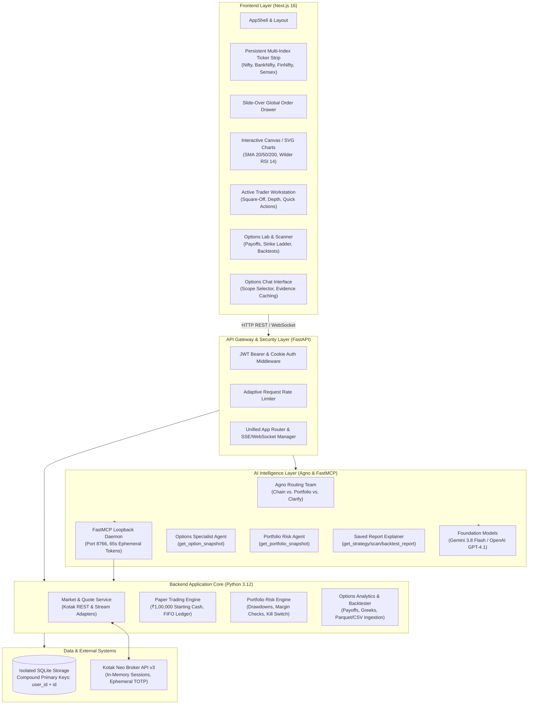
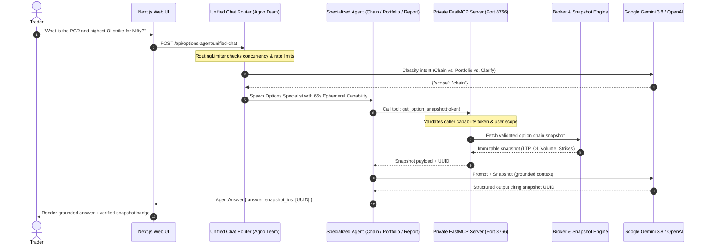

# NeoDesk — Indian Markets Active Trading & Options Intelligence Terminal

[]()
[](https://www.python.org/)
[](https://nextjs.org/)
[](https://fastapi.tiangolo.com/)
[](https://github.com/Kotak-Neo/kotak-neo-python)
[](https://modelcontextprotocol.io/)

A multi-user Indian financial market trading terminal, active trader workstation, and derivatives intelligence platform. NeoDesk unites live NSE/BSE market data, order routing via Kotak Neo, simulated paper portfolios with strict user isolation, an institutional-grade options analytics engine, and an AI chat assistant powered by the Model Context Protocol (MCP).

---

## 🏛️ Comprehensive System Design

NeoDesk is built with a decoupled client-server architecture engineered for real-time responsiveness, zero credential leakage, and multi-tenant isolation.

### End-to-End System Architecture



---

### Key Architectural Subsystems

#### 1. Authentication & Session Isolation
- **Dual-Token System**: User accounts are secured using bcrypt password hashing with short-lived JWT bearer tokens for API calls and HttpOnly cookies for browser navigation.
- **Zero-Storage Broker Auth**: Kotak Neo broker credentials (Consumer Key, UCC, Mobile, MPIN, and TOTP) are received over secure HTTPS at `/login`. MPIN and TOTP are never written to disk, and active session tokens are retained solely in server memory. When the backend terminates, all active broker sessions are immediately purged.
- **Multi-Tenant Scoping**: All relational tables (`watchlists`, `orders`, `positions`, `strategies`, `signals`, `audit_log`, `option_agent_runs`) enforce tenant boundaries using compound primary keys `(user_id, ...)`.

#### 2. Market Data & Order Execution Pipeline
- **Hybrid Quote Engine**: Supports dual sources (`sample` for deterministic demo testing and `kotak` for live market access).
- **Catalogue Matching**: Indexes over 139,000+ NSE/BSE equity and derivatives contracts with instant substring search and token resolution.
- **Paper Trading Engine**:
  - Implements double-entry cash reservations: limit buys immediately reserve required capital; limit sells immediately reserve held asset lots.
  - Realistic FIFO position matching with fractional quantity handling, dynamic average cost updates, and separate tracking of realized vs. unrealized P&L.
- **Live Order Latch**: Live trading requires both `LIVE_TRADING_ENABLED=true` in `.env` and authenticated broker sessions. Idempotency request IDs protect against network duplicate submissions.

#### 3. Derivatives Analytics & Historical Engine
- **Options Payoff Modeler**: Real-time evaluation of multi-leg options structures (Bull Call Spreads, Bear Put Spreads, Long Straddles, Strangles, Iron Condors).
- **Historical Backtesting**: Bounded ingestion of historical CSV and Parquet market data files (up to 10 MiB) with deterministic SHA-256 manifest generation, strict decimal precision, and fee/slippage modeling.
- **Real-Time Scanner**: Parameterized scanner filtering contracts by Moneyness (ITM/ATM/OTM), IV percentiles, volume surges, and OI concentration.

---

## 🤖 Implemented AI Agents Architecture

The platform features an enterprise-grade agentic workflow built on the **Model Context Protocol (MCP)** and **Agno**, designed to ensure strict financial correctness and zero hallucinated execution.



---

### Detailed Agent Inventory

| Agent | Scope | Primary Tools | Model & Budget | Core Responsibility |
|---|---|---|---|---|
| **Chat Router Team** | Global | TeamMode.route | `gemini-3.8-flash` / `gpt-4.1-mini` | Inspects user query and routes to the correct specialist (`chain`, `portfolio`, or `clarify`). Enforces 25s deadline. |
| **Options Specialist** | `chain` | `get_option_snapshot` | Max 2 tool calls, 4096 tokens (Gemini) / 900 tokens (OpenAI) | Analyzes option chains, PCR, strike-level OI, and premiums. Rejects execution and alerts about unverified broker timestamps. |
| **Portfolio Risk Agent** | `portfolio` | `get_portfolio_snapshot` | Max 2 tool calls, 4096 tokens (Gemini) / 900 tokens (OpenAI) | Evaluates user holdings, positions, cash funds, order statuses, and checks portfolio risk policies for breaches. |
| **Saved Report Explainer** | `strategy`, `scan`, `alert`, `backtest` | `get_{kind}_report` | Max 2 tool calls, 4096 tokens (Gemini) / 900 tokens (OpenAI) | Explains immutable backtest or scanner reports, clarifying mathematical assumptions, slippage, and capital limits. |

---

### Agent Security, Guardrails & Harness Controls

1. **Private Loopback FastMCP Server**:
   - The MCP server operates on `127.0.0.1:8766` on an internal loopback interface.
   - External browser origins are strictly blocked (`Origin` validation).
   - Tools cannot accept caller user IDs; capabilities are cryptographically verified using ephemeral 65-second tokens.
2. **Deterministic Evidence Citation**:
   - The model cannot answer from memory alone. It must cite the exact `snapshot_id` or `evidence_id` returned by the MCP tool.
   - Answers omitting the valid snapshot ID fail validation and are rejected before reaching the user.
3. **Execution Safety Latch**:
   - Agents are strictly **read-only**. None of the agent tools have execution, ordering, or fund transfer capabilities.
   - Any order placement must be explicitly composed by the user on the Trade Ticket and confirmed interactively.
4. **Resilient Rate Limiting & Failover**:
   - User concurrency: 1 active request per user, max 4 system-wide concurrent requests.
   - Rate limit: 6 chat attempts per minute per user.
   - Dual-Key Failover: Configurable `GEMINI_BACKUP_API_KEY` and `OPENAI_BACKUP_API_KEY` enable automatic single-retry failover upon encountering 429 quota limits.

---

## ⚡ Active Trader Workstation (`/trading`)

- **Persistent Multi-Index Ticker Strip**:
  - Live tracking of Nifty 50, Nifty Bank, FinNifty, and Sensex.
  - Sub-second UI updates with color-coded positive/negative badges.
- **Global Slide-Over Order Drawer**:
  - Fly-out trade drawer accessible from any route (`/trading`, `/options`, `/stocks`, `/indices`).
  - Supports keyboard shortcuts (`Esc` dismissal) and body scroll lock to prevent scroll stuttering.
- **One-Click Position Square-Off**:
  - Instantly computes inverse order side (`BUY` ↔ `SELL`) and net position quantity.
  - Automatically loads order details into the Trade Ticket with pre-computed margin and limit checks.
- **High-Density Order Book & Market Table**:
  - Compact row layouts displaying LTP, Change %, Volume, Day High/Low, and instant 1-click Buy/Sell triggers.

---

## 🚀 Quick Start

### Prerequisites
- **Node.js**: v24.x or higher
- **Python**: v3.12.x
- **PowerShell** (Windows) or **Bash** (macOS/Linux)

### 1. One-Command Launch (Recommended)
From the repository root in PowerShell:
```powershell
cd neo-trading-terminal
.\run-local.ps1
```
This builds the Next.js frontend, bundles the static distribution, and starts the FastAPI server at `http://127.0.0.1:8000`.

### 2. Manual Installation

#### Backend Setup
```powershell
cd neo-trading-terminal/backend

# Create and activate virtual environment
python -m venv .venv
.\.venv\Scripts\Activate.ps1

# Install locked dependencies
pip install -r requirements.txt -c requirements.lock
```

#### Frontend Setup
```powershell
cd neo-trading-terminal/frontend
npm ci
```

#### Running in Development Mode
Run each service in a separate terminal:
```powershell
# Terminal 1 - Backend (FastAPI on http://127.0.0.1:8000)
cd neo-trading-terminal/backend
.\.venv\Scripts\Activate.ps1
uvicorn app.main:app --reload --host 127.0.0.1 --port 8000

# Terminal 2 - Frontend (Next.js on http://localhost:3000)
cd neo-trading-terminal/frontend
npm run dev
```

---

## ⚙️ Configuration (`.env`)

Copy `.env.example` in `neo-trading-terminal/` to `.env`:
```powershell
cd neo-trading-terminal
cp .env.example .env
```

| Environment Variable | Default | Purpose |
|----------------------|---------|---------|
| `ENVIRONMENT` | `development` | Runtime mode (`development`, `production`, `test`) |
| `TRADING_MODE` | `paper` | Order execution mode (`paper` or `live`) |
| `LIVE_TRADING_ENABLED` | `false` | Master safety latch for real-money orders |
| `PAPER_STARTING_BALANCE` | `100000` | Default paper cash allocated to new users (₹) |
| `MARKET_DATA_SOURCE` | `sample` | Quote engine source (`sample` or `kotak`) |
| `KOTAK_CONSUMER_KEY` | *(blank)* | Kotak Neo Developer API Consumer Key |
| `GEMINI_API_KEY` | *(blank)* | Google AI Studio key for MCP options assistant |
| `OPTIONS_AGENT_MODEL` | `gemini-3.8-flash` | LLM model for the options chat copilot |
| `OPTIONS_MCP_PORT` | `8766` | Private loopback port for the FastMCP daemon |

---

## 🧪 Testing & Empirical Verification

The platform maintains full deterministic test coverage across backend services and frontend components.

### Backend Test Suite (Pytest)
```powershell
cd neo-trading-terminal/backend
$env:PYTHONPATH = "."
.\.venv\Scripts\python.exe -m pytest tests -q
```
*Covers 560+ test cases verifying cash reservation, FIFO trade accounting, duplicate-order idempotency, user data isolation, MCP tool routing, and options chain math.*

### Offline Agent Evals Harness
```powershell
cd neo-trading-terminal/backend
$env:PYTHONPATH = "."
.\.venv\Scripts\python.exe -m app.terminal.options_evals
.\.venv\Scripts\python.exe -m app.terminal.options_evals --scope portfolio
.\.venv\Scripts\python.exe -m app.terminal.options_evals --scope portfolio-risk
.\.venv\Scripts\python.exe -m app.terminal.options_platform_evals
```
*Replays deterministic evaluation cases against the loopback FastMCP server without consuming real model quota.*

### Frontend Test Suite (Node.js Native Test Runner)
```powershell
cd neo-trading-terminal/frontend
npm test
npm run lint
npm run build
```
*Runs 67 frontend test suites verifying UI state stores, Order Drawer lifecycle, Trade Ticket precision, dark theme tokens, and clean static export.*

---

## 📁 Repository Directory Structure

```
TRADING/
├── .github/
│   └── workflows/
│       └── options-harness.yml   # CI pipeline: Pytest, Agent Evals, Node Test, Lint, Build
├── neo-trading-terminal/
│   ├── backend/
│   │   ├── app/
│   │   │   ├── auth/             # User registration, bcrypt hashing, JWT handlers
│   │   │   ├── brokers/          # Kotak Neo broker adapters & session lifecycle
│   │   │   ├── core/             # Pydantic settings & security middleware
│   │   │   ├── terminal/
│   │   │   │   ├── agent_registry.py       # Factory registry for per-request agents
│   │   │   │   ├── agent_scope.py          # Scope boundaries (chain, portfolio, reports)
│   │   │   │   ├── unified_chat.py         # Multi-agent chat router team
│   │   │   │   ├── options_agent.py        # Core Options Specialist agent
│   │   │   │   ├── options_mcp.py          # FastMCP server & ephemeral capabilities
│   │   │   │   ├── options_snapshot.py     # Deterministic market evidence collector
│   │   │   │   ├── portfolio_risk.py       # Portfolio risk assessment engine
│   │   │   │   ├── options_scanner.py      # Algorithmic options scanner
│   │   │   │   └── options_backtest.py     # Historical backtesting engine
│   │   │   └── websocket/        # Real-time WebSocket connection manager
│   │   ├── evals/                # Offline LLM evaluation test cases & rubrics
│   │   ├── examples/             # Sample backtest payloads & synthetic datasets
│   │   ├── tests/                # 560+ backend unit & integration tests
│   │   ├── requirements.txt      # Python dependencies
│   │   └── requirements.lock     # Pinned dependency lockfile
│   ├── frontend/
│   │   ├── src/
│   │   │   ├── components/       # Layout, OrderDrawer, TradeTicket, Charts, RiskPanel
│   │   │   ├── pages/            # Next.js routes (/trading, /options, /connections, /login)
│   │   │   ├── stores/           # Zustand state slices (marketStore, etc.)
│   │   │   └── styles/           # Theme stylesheets, Kotak Neo dark navy palette
│   │   ├── tests/                # Frontend component and logic tests
│   │   └── package.json          # Node dependencies & build scripts
│   ├── docs/                     # Comprehensive architecture & setup guides
│   ├── .env.example              # Sanitized environment template
│   └── run-local.ps1             # Local one-click launch automation
├── .gitignore                    # Root repository ignore rules (secrets, databases, logs)
└── README.md                     # Master project documentation
```

---

## 🔒 Security & Safe Trading Safeguards

1. **Paper-First Default**: The terminal defaults strictly to simulated paper trading with ₹1,00,000 in virtual funds. Real order dispatch requires explicit `LIVE_TRADING_ENABLED=true` in `.env` and authenticated broker login.
2. **Ephemeral Broker Credentials**: Consumer Key, UCC, Mobile, MPIN, and TOTP are never written to database tables or logs. When the server restarts, all broker session states vanish from RAM.
3. **Strict Database Isolation**: All database operations in SQLite use compound primary keys (`user_id`, `...`) ensuring zero cross-tenant visibility.
4. **No LLM Hallucinated Execution**: The Options Chat Agent operates over read-only MCP endpoints; it cannot execute live orders on your behalf without manual confirmation on the Trade Ticket.

---

## 📜 License

This project is licensed under the MIT License — see the [LICENSE](LICENSE) file for details.
