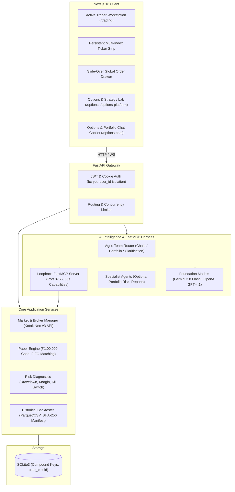
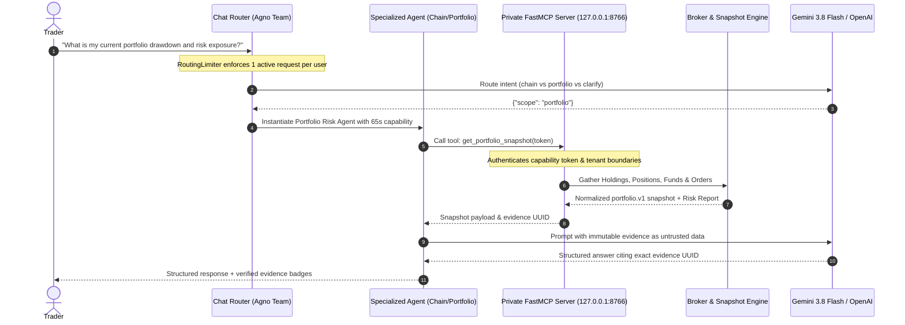

# NeoDesk — Indian Markets Active Trading & Options Intelligence Terminal

[]()
[](https://www.python.org/)
[](https://nextjs.org/)
[](https://fastapi.tiangolo.com/)
[](https://github.com/Kotak-Neo/kotak-neo-python)
[](https://modelcontextprotocol.io/)

A connected Next.js 16 frontend and FastAPI backend multi-user trading platform, featuring an active trader workstation, Kotak Neo broker integration, simulated ₹1,00,000 paper trading accounts, an options engineering suite, and an AI copilot using the Model Context Protocol (MCP).

---

## 🏛️ System Design & Architecture



---

## 🤖 Implemented AI Agents Architecture

The platform implements a multi-agent system built on **Agno** and the **Model Context Protocol (MCP)**, enforcing strict financial evidence grounding, token budgets, and zero unassisted order execution:



### Agents Specification

1. **Unified Chat Router Team (`unified_chat.py`)**:
   - Built with Agno `TeamMode.route` containing 3 specialized agents: Options Specialist (`chain`), Portfolio Specialist (`portfolio`), and Clarification Specialist (`clarify`).
   - Guarded by `RoutingLimiter` (1 active request per user, max 4 concurrent requests system-wide, max 6 requests per minute per user, 25-second deadline).
2. **Options Specialist Agent (`options_agent.py`)**:
   - Scope: `chain`.
   - Tool: `get_option_snapshot` over private FastMCP protocol.
   - Enforces strict numeric grounding on real-time option chain snapshots (strikes, premiums, volume, OI, PCR).
   - Rejects live execution requests and explicitly warns that broker REST data has unverified exchange freshness.
3. **Portfolio Risk Agent (`agent_scope.py`, `portfolio_risk.py`)**:
   - Scope: `portfolio`.
   - Tool: `get_portfolio_snapshot` over FastMCP.
   - Analyzes holdings, open positions, cash balances, and pending orders.
   - Evaluates real-time risk policies (`portfolio-risk.v1`): drawdown limits, single-order caps, sector exposure, and circuit breakers.
   - Output schema: `PortfolioAnswer` citing the exact `evidence_id` and `risk_report_ids`.
4. **Saved Report Explainer (`agent_scope.py`, `report_scope`)**:
   - Scopes: `strategy`, `scan`, `alert`, `backtest`.
   - Tool: `get_{kind}_report`.
   - Grounded exclusively on immutable saved report objects; cannot alter settings, start jobs, or trigger broker actions.
5. **Private FastMCP Server Harness (`options_mcp.py`)**:
   - Streamable HTTP server on localhost loopback (`127.0.0.1:8766`).
   - Ephemeral capability tokens (65-second lifetime) bound to `(user_id, scope, run_id)`.
   - Rejects all browser origins; client cannot pass user IDs or manipulate credentials.
   - Strict execution budgets: max 3 model requests, max 2 agent tool calls, 900 completion tokens (OpenAI) / 4096 generation tokens (Gemini).
   - Automatic fallback & backup key rotation (`GEMINI_BACKUP_API_KEY`, `OPENAI_BACKUP_API_KEY`) on 429 rate limits.

---

## ⚡ Active Trader Workstation (`/trading`)

- **Persistent Multi-Index Ticker Strip**: Real-time ticker tracking Nifty 50, Bank Nifty, FinNifty, and Sensex with custom color-coded badges and quote updates.
- **Global Order Drawer**: Slide-over drawer accessible from any page with keyboard shortcuts (`Esc` to dismiss) and body scroll locking.
- **Position Square-Off**: One-click position square-off that automatically calculates the inverse side and quantity and loads it into the trade ticket.
- **Rapid Watchlist & Trade Actions**: Compact row density with instant Buy/Sell quick action buttons.

---

## 🚀 Quickstart

### Launch with PowerShell Script
```powershell
.\run-local.ps1
```
Open [http://127.0.0.1:8000](http://127.0.0.1:8000) in your browser. The script compiles the Next.js frontend, packages the static export, and starts the FastAPI server.

To skip rebuilding the frontend if files haven't changed:
```powershell
.\run-local.ps1 -SkipBuild
```

### Manual Setup

#### 1. Backend
```powershell
cd backend
python -m venv .venv
.\.venv\Scripts\Activate.ps1
pip install -r requirements.txt -c requirements.lock
```

#### 2. Frontend
```powershell
cd frontend
npm ci
```

#### 3. Development Servers
- Backend: `uvicorn app.main:app --reload --host 127.0.0.1 --port 8000` (from `backend/` in `.venv`)
- Frontend: `npm run dev` (from `frontend/`, opens at `http://localhost:3000`)

---

## ⚙️ Configuration (`.env`)

Copy `.env.example` to `.env` in `neo-trading-terminal/`:

```ini
ENVIRONMENT=development
PAPER_STARTING_BALANCE=100000
TRADING_MODE=paper
LIVE_TRADING_ENABLED=false
MARKET_DATA_SOURCE=sample

# Kotak Neo Broker Credentials (or enter via UI at /login)
KOTAK_CONSUMER_KEY=
KOTAK_UCC=
KOTAK_MOBILE_NUMBER=
KOTAK_ENVIRONMENT=prod

# AI Options Assistant
GEMINI_API_KEY=
OPTIONS_AGENT_PROVIDER=gemini
OPTIONS_AGENT_MODEL=gemini-3.8-flash
OPTIONS_AGENT_ENABLED=true
OPTIONS_MCP_PORT=8766
```

---

## 🧪 Testing & Empirical Verification

```powershell
# Run backend tests (560+ test cases)
cd backend
$env:PYTHONPATH = "."
.\.venv\Scripts\python.exe -m pytest tests -q

# Run offline agent eval replay
.\.venv\Scripts\python.exe -m app.terminal.options_evals
.\.venv\Scripts\python.exe -m app.terminal.options_evals --scope portfolio
.\.venv\Scripts\python.exe -m app.terminal.options_evals --scope portfolio-risk
.\.venv\Scripts\python.exe -m app.terminal.options_platform_evals

# Run frontend tests (67 test suites)
cd ..\frontend
npm test

# Run frontend linter & production build
npm run lint
npm run build
```

---

## 📜 Technical Guides

- [Options Agent & MCP Harness Guide](docs/OPTIONS_AGENT.md)
- [Options Workspace & Data Specifications](docs/OPTIONS_PLATFORM.md)
- [Kotak SDK & Market Data Documentation](docs/DATA_AND_TRADINGVIEW.md)
- [Render Cloud Deployment Guide](docs/DEPLOY_RENDER.md)
