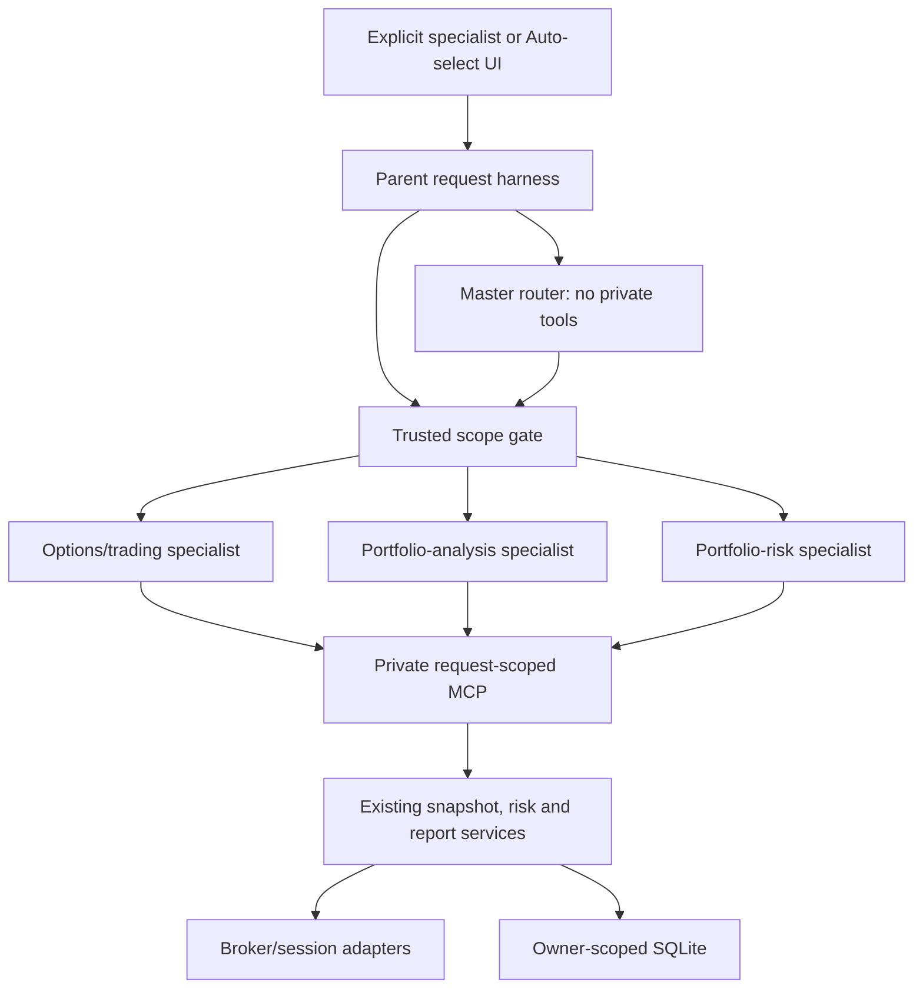

# Dedicated Specialist Agents — Cumulative Implementation Plan

> **For agentic workers:** REQUIRED SUB-SKILL: use `superpowers:subagent-driven-development` or `superpowers:executing-plans`; use `superpowers:test-driven-development` for every behavior change and `superpowers:verification-before-completion` before completion claims. Complete plans 01–06 in dependency order.

**Goal:** Replace the registered `options_monitor` catch-all with three independent read-only specialists—options/trading analysis, portfolio analysis, and portfolio risk—plus a master router, while preserving existing calculations, retrieval, saved reports, owner isolation, UI workflows, and historical reads.

**Architecture:** Retain the FastAPI runner, private FastMCP listener, broker/session services, deterministic calculations, SQLite stores, and pinned Agno 3.1.10. The master classifies without private tools; trusted backend code then grants exactly one request-scoped capability to one fresh specialist. Add a shared harness for cumulative deadlines, model/tool budgets, context isolation, tracing, and evaluations.

**Deferred:** Ollama, memory, covered-call/collar specialists, new research sources, agent order execution, agent policy editing, and new financial formulas.

**Baseline:** inspected commit `a54d9e1` on branch `codex/local-specialist-agents`. At planning time this plan is the only workspace change.

## Target map

| Factory | Responsibility | Authorized private tool | Contract |
|---|---|---|---|
| `options_trading_analysis` | Option-chain and selected saved strategy/scan/alert/backtest explanations | `get_option_snapshot`, or exactly one selected report tool | Existing `AgentAnswer` / `ReportAnswer` |
| `portfolio_analysis` | Holdings, positions, funds, orders, quality and freshness | `get_portfolio_analysis_snapshot` | `PortfolioAnalysisAnswer` |
| `portfolio_risk` | Existing deterministic checks, breaches, passes, disabled/cannot-assess findings | `get_portfolio_risk_report` | `PortfolioRiskAnswer` |
| `master_router` | Route to chain, portfolio, risk or clarification | None | `RouteAnswer` |



## Contracts and invariants

- Preserve existing options chat/snapshot, full portfolio snapshot/chat, saved-report explanation, history, and run-record endpoints.
- Add authenticated `POST /api/options-agent/portfolio/risk/chat` using `PortfolioChatRequest`. Return `answer`, `conversation_id`, `run_id`, `parent_run_id`, `agent_id`, `evidence_ids`, `risk_report_ids`, `risk_snapshot`, `created_at`, and `read_only`.
- Unified chat adds scope `risk`. Add `agent_id` and `parent_run_id` additively. Clarification returns a parent ID without creating a specialist conversation.
- `PortfolioAnalysisAnswer`: forbid extras, non-empty answer, exactly one UUID evidence ID, no risk citation. `PortfolioRiskAnswer`: forbid extras, non-empty answer, exactly one UUID evidence ID and risk-report ID. `RouteAnswer`: forbid extras; `chain | portfolio | risk | clarify`.
- New contexts store `agent_id`, scope, contract version, and selected market/report identity. Analysis uses `analysis.1`; risk uses `risk.1`. Legacy mixed portfolio conversations remain readable but continuation through a new specialist returns HTTP 409 with code `conversation_scope_changed`.
- Keep legacy `get_portfolio_snapshot` for snapshot/UI/offline consumers; expose it to neither specialist. Analysis gets a validated `PortfolioSnapshot` projection without risk. Risk gets only `{evidence_id, risk_report}` with matching IDs and no account rows.
- Acquire portfolio evidence and calculate risk once. Keep the full envelope in private request state. Never expose a broad accessor through MCPConnection, tools, prompts, or logs. Only the trusted runner reads it for compatible UI response and persistence. Return detached projections.
- Explicit selection bypasses the master. Selected reports bypass classification and remain owner/report bound. Mixed/unsupported requests clarify instead of granting multiple scopes.
- Read-only behavior remains: no agent order placement, policy mutation, job creation, or new calculation logic.

## Harness engineering contract

Lifecycle: authenticate → admit once → validate conversation → route if needed → bind capability → acquire immutable evidence → project/bound context → run specialist → validate schema/citations → recheck session → publish atomically → revoke/release.

- Explicit parent deadline: 60 seconds. Auto parent deadline: 85 seconds, containing existing 25-second routing and 60-second specialist limits. Child stages never reset deadlines or admission.
- Preserve one active request/user, six admissions/minute/user, four active globally, two model-requested specialist tool calls, and three private reads including prefetch.
- Router/member calls share three provider attempts; specialist calls share three. Auto has six total, explicit three. Retries and backup keys consume the same counters.
- Preserve Gemini 4,096 and OpenAI 900 stage generation allowances. Missing usage reserves the full requested allowance; record actual usage only when reported.
- Add validated `AGENT_INPUT_TOKEN_ESTIMATE_LIMIT=24000` and `AGENT_CONTEXT_TOKEN_LIMIT=32768`; require input limit + provider generation allowance ≤ context limit. Retain the 65,536-byte prompt ceiling.
- Estimate the complete provider request: instructions, tool schemas, question, compatible history, evidence, and tool results. Label byte-derived values as estimates. Drop oldest history first; never remove required IDs, freshness/missing states, findings, or limitations.
- Isolate history by owner, agent, scope, contract and selected context. Use at most four compatible turns. The router sees trusted current scope plus current/previous user questions as untrusted text, never answers or evidence. Elliptical follow-ups remain scoped; topic changes return 409 before fetching new evidence.
- Use stable routing/scope/context/model-budget/tool-budget/timeout/evidence/output/provider failure codes. Failed validation never persists a successful turn.
- Reuse `option_agent_runs` JSON for parent/child traces. Record stages, versions, IDs, token estimates/actual availability, attempts, delegation/tool/broker/cache counts and failures. Never record prompts, answers, provider bodies, credentials, capability tokens, or account rows.

## Dependency graph

| Plan | Wave | Depends on | Deliverable |
|---|---:|---|---|
| 01 | 1 | — | Specialist contracts and factories |
| 02 | 2 | 01 | MCP projections and authorization matrix |
| 03 | 3 | 01 | Shared budgets, context and trace primitives |
| 04 | 4 | 02, 03 | Runtime dispatch, risk API, history and master |
| 05 | 5 | 04 | Explicit/Auto UI |
| 06 | 5 | 04 | Evaluations, retirement proof and docs |

Plans 05 and 06 may run in parallel after Plan 04 freezes API contracts.

---

## Plan 01 — Specialist contracts and factories

```yaml
phase: specialist-agents
plan: "01"
wave: 1
depends_on: []
files_modified: [agent_scope.py, agent_registry.py, specialist_agents.py, test_specialist_agents.py]
autonomous: true
must_haves:
  truths: [Independent factories and strict contracts exist, No generic factory accepts every scope]
  key_links: [AgentScope.agent_id resolves exactly one factory]
```

### Task 01.1 — Define scopes and strict answers

**Files:** modify `backend/app/terminal/agent_scope.py`; create `backend/tests/test_specialist_agents.py`.

**Action:** Write failing tests for scope→agent mappings, strict answers, prompt versions and invalid pairings. Add `agent_id`; split portfolio instructions into analysis/risk; add both new contracts; map chain and saved-report scopes to options/trading. Keep arithmetic outside prompts.

**Verify:** `python -m pytest tests/test_specialist_agents.py -q` fails before implementation and passes after.

**Done:** every supported scope has one versioned instruction set, contract, tool and agent; unknown combinations fail closed.

### Task 01.2 — Register fresh specialist factories

**Files:** create `backend/app/terminal/specialist_agents.py`; modify `backend/app/terminal/agent_registry.py` and `backend/tests/test_specialist_agents.py`.

**Action:** Test first, then register three factories with `(config, snapshot, tools, *, scope) -> Agent`. Each validates scope, creates a fresh model/Agent, uses only supplied tools, and applies the scope schema. Widen typing for a later Team factory; store no live instances. Keep the old production factory until Plan 04 migrates callers.

**Verify:** `python -m pytest tests/test_specialist_agents.py -q` passes for fresh instances/budgets and wrong-scope rejection.

**Done:** registry resolves three non-catch-all specialists.

---

## Plan 02 — Private MCP evidence boundaries

```yaml
phase: specialist-agents
plan: "02"
wave: 2
depends_on: ["01"]
files_modified: [options_mcp.py, test_specialist_mcp.py, test_portfolio_mcp.py, AGENTS.md]
autonomous: true
must_haves:
  truths: [Analysis cannot read risk, Risk cannot read account rows, Direct protocol cannot bypass permissions]
  key_links: [Capability scope filters discovery and invocation server-side]
```

### Task 02.1 — Implement detached projections

**Files:** modify `backend/app/terminal/options_mcp.py`; create `backend/tests/test_specialist_mcp.py`.

**Action:** Write failing loopback tests, then add analysis/risk scopes and tools. Reuse one owner/session/policy-bound acquisition and risk evaluation. Keep full envelope private; return detached validated projections. Apply deadline, generation, cancellation, cache and tool budgets to both scopes.

**Verify:** `python -m pytest tests/test_specialist_mcp.py -q` passes for contents, matching IDs, immutable repeats, one fetch, stale sessions, cancellation, and deadlines.

**Done:** each specialist receives minimum evidence without a broad model-visible handle.

### Task 02.2 — Prove authorization matrix

**Files:** modify `backend/tests/test_specialist_mcp.py`, `backend/tests/test_portfolio_mcp.py`, and `AGENTS.md`.

**Action:** Add a parameterized matrix for chain, analysis, risk, and four report scopes against every private tool including legacy portfolio. Test discovery and invocation, arguments, expiry/revocation, origin rejection, and router-with-no-capability. Update the engineering boundary.

**Verify:** `python -m pytest tests/test_specialist_mcp.py tests/test_portfolio_mcp.py tests/test_options_mcp.py -q` passes; each capability exposes exactly one tool.

**Done:** clients, prompts, and direct calls cannot widen access.

---

## Plan 03 — Shared harness engineering

```yaml
phase: specialist-agents
plan: "03"
wave: 3
depends_on: ["01"]
files_modified: [agent_harness.py, options_model.py, options_gemini.py, config.py, test_agent_harness.py, test_agent_harness_traces.py]
autonomous: true
must_haves:
  truths: [Nested work cannot reset budgets/deadlines, Context/traces do not leak evidence]
  key_links: [Provider adapters consume one request-local budget before every SDK call]
```

### Task 03.1 — Enforce cumulative budgets and context

**Files:** create `backend/app/terminal/agent_harness.py`, `backend/tests/test_agent_harness.py`; modify `backend/app/core/config.py` and `backend/app/terminal/options_model.py`.

**Action:** Test sibling isolation, cumulative attempts, retry/key rotation, unknown usage, expired deadlines, and oversized assembled requests first. Implement request-local parent/stage budgets via ContextVar, validated settings, and reserve/account hooks at provider boundaries. Preserve provider selection and generation limits.

**Verify:** `python -m pytest tests/test_agent_harness.py tests/test_options_model.py tests/test_key_rotator.py -q` passes and blocks the next SDK call before a limit breach.

**Done:** explicit/Auto work has bounded non-resettable attempts, generation, context, and deadlines.

### Task 03.2 — Integrate Gemini accounting and sanitized traces

**Files:** modify `backend/app/terminal/options_gemini.py`, `backend/app/terminal/agent_harness.py`, and `backend/tests/test_agent_harness.py`; create `backend/tests/test_agent_harness_traces.py`.

**Action:** Test reasoning/output/total accounting, unknown reservation, redaction, terminal traces, and cancellation first. Integrate Gemini with shared budgets. Implement trace builders, stage timers, and stable failure codes; storage wiring follows in Plan 04.

**Verify:** `python -m pytest tests/test_agent_harness.py tests/test_agent_harness_traces.py tests/test_options_gemini.py -q` passes.

**Done:** adapters account consistently and traces contain metadata without private content.

---

## Plan 04 — Runtime, history and master router

```yaml
phase: specialist-agents
plan: "04"
wave: 4
depends_on: ["02", "03"]
files_modified: [options_agent.py, routers/options_agent.py, unified_chat.py, test_specialist_api.py, test_unified_routing.py, test_portfolio_agent.py]
autonomous: true
must_haves:
  truths: [Real requests execute the designated specialist, Master owns no capability, History stays isolated, Catch-all is removed]
  key_links: [Validated router output precedes trusted capability creation]
```

### Task 04.1 — Dispatch explicit specialist APIs

**Files:** modify `backend/app/terminal/options_agent.py`, `backend/app/terminal/routers/options_agent.py`, `backend/tests/test_portfolio_agent.py`; create `backend/tests/test_specialist_api.py`.

**Action:** Add failing API tests, then resolve `agent_id` via registry. Add risk chat and compatible publication; model input receives projections only. Integrate parent admission/budgets/traces, exact citations, generation rechecks, atomic persistence, and history isolation. Remove external tools from specialist runs. After migrating callers, delete `@register_agent('options_monitor')` and generic builder.

**Verify:** `python -m pytest tests/test_specialist_api.py tests/test_portfolio_agent.py tests/test_options_agent.py tests/test_options_report_chat.py -q` passes; `rg` finds no active catch-all call.

**Done:** options/report, analysis, and risk endpoints run distinct specialists; invalid output never persists.

### Task 04.2 — Register and integrate master router

**Files:** modify `backend/app/terminal/unified_chat.py`, `backend/app/terminal/agent_registry.py`, `backend/tests/test_unified_routing.py`, and `backend/tests/test_specialist_api.py`.

**Action:** Test first, then register fresh `master_router` TeamMode.route with chain/portfolio/risk/clarify members and no tools. Validate ownership before follow-up routing; enforce sticky scope and 409 topic changes before fetch. Saved reports bypass routing. Record router/specialist metrics under one parent.

**Verify:** `python -m pytest tests/test_unified_routing.py tests/test_specialist_api.py -q` passes for real mocked transport, elliptical follow-up, topic change, cross-user ID, clarification, and report bypass.

**Done:** routing reaches all specialists without granting data access to the master.

---

## Plan 05 — Specialist and Auto-select UI

```yaml
phase: specialist-agents
plan: "05"
wave: 5
depends_on: ["04"]
files_modified: [options-chat.tsx, specialist-agents.test.cjs, portfolioRisk.test.cjs]
autonomous: true
must_haves:
  truths: [Users can choose specialists or Auto, Late replies cannot render under another scope]
  key_links: [Each choice calls and renders its matching contract]
```

### Task 05.1 — Add specialist choices and rendering

**Files:** modify `frontend/src/pages/options-chat.tsx`, `frontend/tests/portfolioRisk.test.cjs`; create `frontend/tests/specialist-agents.test.cjs`.

**Action:** Read frontend AGENTS.md and installed Next.js docs. Test first, then add three choices. Risk posts to risk endpoint/render RiskPanel; analysis renders PortfolioEvidence; options keeps chain display. Switching invalidates pending work and starts a conversation.

**Verify:** `npm test -- specialist-agents.test.cjs portfolioRisk.test.cjs` passes.

**Done:** explicit selection works using existing evidence components.

### Task 05.2 — Add Auto-select and safe follow-ups

**Files:** modify `frontend/src/pages/options-chat.tsx` and `frontend/tests/specialist-agents.test.cjs`.

**Action:** Test first, then add Auto calling unified chat. Render scope/agent; clarification has no evidence. On scope-change preserve typed text and offer New chat without resubmission. Disable periodic refresh until a concrete scope; retain stale-response revision guards.

**Verify:** `npm test`, `npm run lint`, and `npm run build` all pass.

**Done:** Auto works end-to-end without mixed history or stale reply rendering.

---

## Plan 06 — Evaluations, retirement proof and docs

```yaml
phase: specialist-agents
plan: "06"
wave: 5
depends_on: ["04"]
files_modified: [specialist_evals.py, options_evals.py, specialist_cases.json, specialist_rubric.json, test_specialist_evals.py, OPTIONS_AGENT.md]
autonomous: true
must_haves:
  truths: [Offline correctness is separate from model quality, No catch-all path remains]
  key_links: [Evaluations use production factories, projections and validation]
```

### Task 06.1 — Build specialist evaluation harness

**Files:** create `backend/app/terminal/specialist_evals.py`, `backend/evals/specialist_cases.json`, `backend/evals/specialist_rubric.json`, and `backend/tests/test_specialist_evals.py`.

**Action:** Test first, then add versioned development/held-out cases with independently checked route, tool, references, numeric expectations, and forbidden claims. Cover normal/partial/stale/missing data, injection, scope changes, forged citations, timeout, and provider failure. Emit sample counts, routing/numeric/citation/abstention results, calls, and p50/p95 latency. Live mode is explicit opt-in.

**Verify:** `python -m pytest tests/test_specialist_evals.py -q` and `python -m app.terminal.specialist_evals --mode offline` pass.

**Done:** reports label dataset/rubric/model/prompt/tool/calculation versions and never treat offline replay as model quality.

### Task 06.2 — Migrate evaluations and release verification

**Files:** modify `backend/app/terminal/options_evals.py`, `docs/OPTIONS_AGENT.md`, and only eval tests found by `rg "build_agent|options_monitor" backend/tests backend/app`.

**Action:** Update failing eval tests to registered factories/projections. Remove obsolete calls without a compatibility catch-all. Document mapping, endpoint, history restart, limits, interpretation, and Ollama deferral. Run all release checks and an independent whole-branch review; fix Critical/Important findings via failing tests.

**Verify:** backend: `python -m pip check`, full pytest, options evals for chain/portfolio/risk, options-platform evals, specialist offline eval. Frontend: tests, lint, build. `rg "register_agent\('options_monitor'\)|\bbuild_agent\(" backend/app backend/tests` returns no catch-all references.

**Done:** checks pass or pre-existing failures are evidenced; compatibility holds; final review has no unresolved Critical/Important findings.

## Release gates

- All deterministic, authorization, isolation, cancellation, and history tests pass.
- Authorization matrix has zero unauthorized discovery/invocation.
- Accepted outputs cite exact authorized IDs; invalid outputs never persist.
- Held-out routing target ≥95%; supported factual claims ≥95% under human review; numeric fixture expectations match independently checked answers.
- Zero critical fabricated values, false execution claims, or false freshness/current-safety claims.
- Offline/mock and live quality remain separate. No live-model claim without explicit live evaluation.
- Measure router/specialist calls, tokens, queue time and p50/p95 latency separately; no invented hardware-independent threshold.

## Plan-check result

**Status: PASSED after consolidation and restructuring.**

- Coverage: every requested agent, tool boundary, catch-all removal, UI, history, harness, trace and evaluation requirement has a task.
- Completeness: all 12 tasks contain exact files, action, executable verification, and measurable done criteria.
- Dependencies: acyclic `01 → {02,03} → 04 → {05,06}` with consistent waves.
- Key links: registry→runner, router→scope gate, MCP→services, API→UI, and production→evaluation are explicit.
- Scope sanity: two tasks per plan; tasks own 2–4 primary files except bounded release verification.
- Verification: every gate derives from specialist separation, security, compatibility, or harness requirements.

**Estimated execution:** 6–10 active hours, depending on baseline failures and full-suite runtime. Ollama and live local-model evaluation remain separate work.
